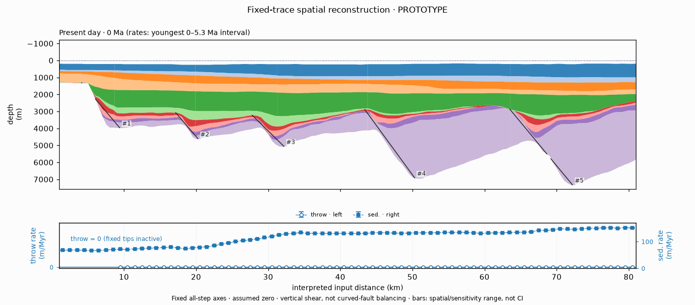
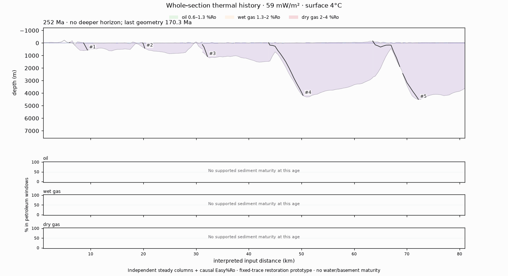

<p align="center"></p>
<p align="center">
<a href="https://doi.org/10.5281/zenodo.23832018"></a> <a href="https://doi.org/10.1038/s43247-022-00429-2"></a> <a href="LICENSE"></a>
<br>
<a href="https://pypi.org/project/pybasinsubs/"></a> <a href="https://pypi.org/project/pybasinsubs/"></a> <a href="https://pepy.tech/projects/pybasinsubs"></a> <a href="https://anaconda.org/conda-forge/pybasinsubs"></a> <a href="https://anaconda.org/conda-forge/pybasinsubs"></a>
</p>

# pyBasinSubs

> [!WARNING]
> Under active development. Many functions, especially fault restoration, are experimental and not fully validated. Use geological constraints; a restored section is not a unique solution.

**pyBasinSubs** is a tool for **1-D and 2-D backstripping and decompaction basin analysis**, with a user-friendly, semi-automated workflow. Start with a well, stratigraphic column or interpreted section; explore subsidence, burial, thermal history and structural restoration in the local browser app or Python notebooks.

## Citation

Lai, L.S.-H. (2026) pyBasinSubs. *Zenodo*, [doi:10.5281/zenodo.23832018](https://doi.org/10.5281/zenodo.23832018) (concept DOI).

Please also cite the method paper: Lai et al. (2022), *Extremely rapid up-and-down motions of island arc crust during arc-continent collision*, [Communications Earth & Environment 3, 100](https://doi.org/10.1038/s43247-022-00429-2).

Code: **AGPL-3.0-or-later**. Data and method credits are in [NOTICE](NOTICE), including Sodir, Roberts et al. (1998), Miller et al. (2020) and IHFC (2024). The Miller sea-level curve is downloaded on first use, not bundled; its non-commercial terms still apply.

## Install and run

Requires Python 3.10 or newer. Install the published package:

```bash
pip install pybasinsubs
```

Start the local browser app:

```bash
pybasinsubs-app
```

For an optional editable install from source, run this from the project folder:

```bash
pip install -e .
```

`python -m pybasinsubs.webapp` also starts the app. It runs locally; your input files stay on your computer. `pybasinsubs-ui` is an alias, and `pybasinsubs-tracer` opens the fault editor directly.

## 1-D: from a well to basin history

Backstrip sediment loads with **Airy isostasy and decompaction**, including erosion, over-compaction and Monte Carlo uncertainty. Use a bundled well or your own column CSV. Optional thermal tools cover geotherms, McKenzie stretching-factor fits, burial temperature and Easy%Ro maturity.


*North Sea well 30/4-1 — **1-D Airy backstripping + decompaction**, oldest → youngest, with a time-evolving thin stratigraphic column.*


*North Sea well 30/4-1 — **thermal column + geotherm**, with kinetic Easy%Ro oil, wet-gas and dry-gas windows.*

## 2-D: strip layers, restore and inspect rates

Use correlated horizons, unit properties and interpreted fault sticks for **flexural backstripping and decompaction**. Explore cantilever, listric and domino restoration options, or the fixed-trace growth-history prototype below.


*Viking Graben VG1 — **fixed-trace vertical-shear reconstruction**: one stripped unit per timestep, remaining slipped/top-clipped traces, and aligned apparent-throw and decompacted sedimentation rates. Frame shape and axes stay fixed; numeric VG1 ages are retained.*


*Viking Graben VG1 — **whole-section thermal history** at 59 mW/m², oldest → modern: red isotherms and translucent kinetic Easy%Ro oil, wet-gas and dry-gas windows over the restored section, with three 0–100% strips showing one line per remaining unit in its unit color, lightly shaded underneath. Independent steady columns, not 2-D heat conduction.*

The growth prototype infers **nonnegative, distributed apparent throw** after stripping, decompaction and flexural unloading, regularized along approximately 1-km knots within fixed hanging-wall partitions. It is **not resolved down-dip slip, geological heave or curved-fault balancing**. Zero is an assumed datum. The footwall of the westernmost fault (#1) is flattened separately toward the datum and is not counted as throw. Traces remain user-controlled inputs; default VG1 traces were not replaced, and the optional tip-extension assist was not applied. The oldest interval retains the last constrained 170.3-Ma geometry, not an inferred 252-Ma section.

## The local browser app

The start page has the package logo and **two symbolic function buttons**. **Fault editor** is available from Start and the 2-D workflow, not inside the 1-D wizard or as a third landing card. A small footer stays outside the workspace: “Project by Larry Syu-Heng Lai, PhD.” at the left and “AGPL-3.0 or later license” at the right.

The app uses isolated numbered left-step wizards: open/edit inputs, choose or fit compaction curves, compute, then export. Return to Start to choose a different analysis. Earlier edits invalidate downstream results. Real-point fits and geothermal imports are explicit. Choose one dataset; porosity-curve checkboxes control the plot, not which unit lithologies are decompacted.

The 1-D steps are **stratigraphy + aligned paleo-water inputs → compaction relations → geohistory + table → geothermal conditions + thermal plots/tables → export**. The 2-D steps are **interpreted section → compaction relations → ordinary flexural backstripping/decompaction → explicit growth reconstruction + rates → thermal history (isotherms, Easy%Ro window overlays and percent-in-window lines) → export**. Real porosity points are shown and used for supported fits when supplied; sparse or unsuitable data retain the chosen curves. Bundled VG1/well-top examples provide model curves, not measured porosity logs.

### 1-D column demo

[](image/videos/pyBasinSubs_column_demo.mp4)
*North Sea well 30/4-1 — **step-by-step Airy backstripping + thermal history**: dataset and porosity choices → geohistory (500 Monte Carlo draws) → thermal history at 59 mW/m². Age sliders drive the thin stratigraphic column and the paired geotherm / burial-temperature / Easy%Ro views. Sped-up demo. Click it to [watch the 1080p video](image/videos/pyBasinSubs_column_demo.mp4) (about 38 seconds).*

### 2-D section demo

[](image/videos/pyBasinSubs_section_demo.mp4)
*Viking Graben VG1 — **step-by-step flexural backstripping, growth reconstruction + thermal history**: dataset and porosity menus → Run section → explicit Reconstruct growth / Show rates, every geological timestep down and back with aligned apparent-throw and sedimentation rates → Compute thermal history at 59 mW/m², with isotherms, Easy%Ro windows and percent-in-window lines through the same timesteps. Sped-up demo. Click it to [watch the 1080p video](image/videos/pyBasinSubs_section_demo.mp4) (about 50 seconds).*

Growth reconstruction does **not** run on page load or ordinary **Run section**. Blank section uploads use the bundled VG1 template; supply both horizons and units CSVs for your own section, plus optional fault sticks.

### Interpret your own fault traces


*Viking Graben — **fault-stick digitizing**: edit interpreted x–depth traces, undo changes and save JSON or CSV, with a restoration preview. The geometry is an interpretation, not a balanced solution.*

## Quick start in Python

```python
from pybasinsubs import from_sodir, backstrip
from pybasinsubs.plotting import geohistory

result = backstrip(from_sodir("30/4-1"), n=500)
geohistory(result)
result.summary()
```

Use `read_column("my.csv")` for your own column, or `from_basinsubs("N")` for the northern Coastal Range example; both are available from `pybasinsubs`. The `legacy` module retains the original [BasinSubs R workflow](https://github.com/GeoLarryLai/BasinSubs).

## Notebooks

The executed [notebooks](notebooks/) explain data preparation, assumptions and validation, using the same calculation engines as the app.

| Start here | What you will learn |
|---|---|
| [1 · Porosity](notebooks/pyBasinSubs_1_porosity_fit.ipynb) / [2 · Paleo-water depth](notebooks/pyBasinSubs_2_paleowater_depth.ipynb) | Compaction fits and water-depth estimates from microfossils. |
| [3 · Coastal Range](notebooks/pyBasinSubs_3_coastal_range_backstrip.ipynb) / [4 · R parity](notebooks/pyBasinSubs_4_R_parity.ipynb) | Taiwan subsidence examples and checks against the original workflow. |
| [5 · Your data and the app](notebooks/pyBasinSubs_5_own_data_and_UI.ipynb) | Column/section CSV templates and browser workflows. |
| [6 · Thermal history](notebooks/pyBasinSubs_6_north_sea_thermal.ipynb) | North Sea and Barents Sea temperature and maturity. |
| [7 · Well-transect flexure](notebooks/pyBasinSubs_7_2D_flexure.ipynb) | Well-based loads, flexural profiles and elastic-thickness sensitivity; not fault-resolved restoration. |
| [8 · 2-D backstripping](notebooks/pyBasinSubs_8_2d_flexural_backstripping.ipynb) / [9 · Fault interpretation](notebooks/pyBasinSubs_9_fault_interpretation.ipynb) | Correlated sections, interpreted faults, restoration comparisons and the growth prototype. |

Release history and migration notes: [CHANGELOG.md](CHANGELOG.md).
