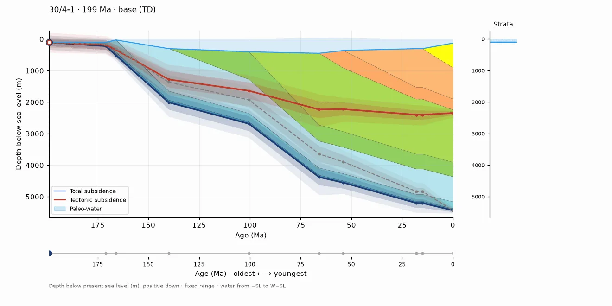
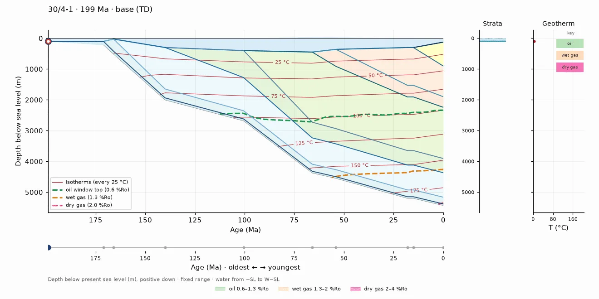
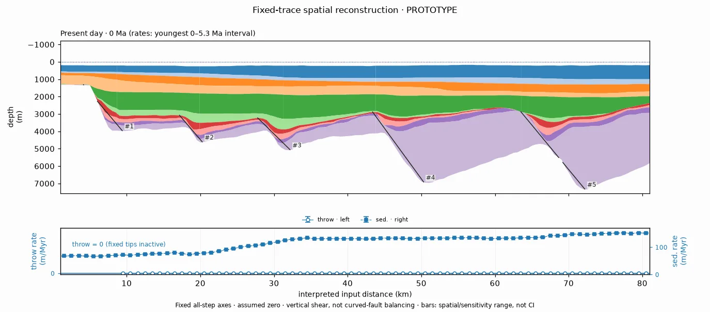
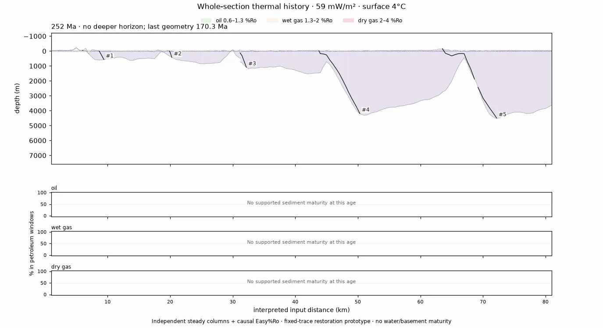
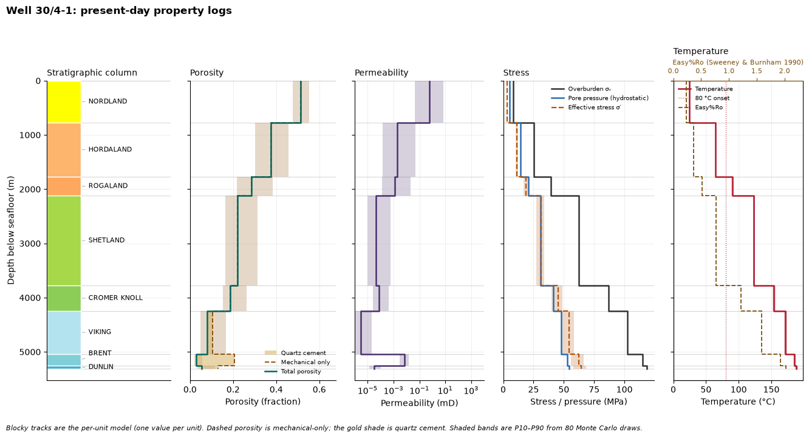
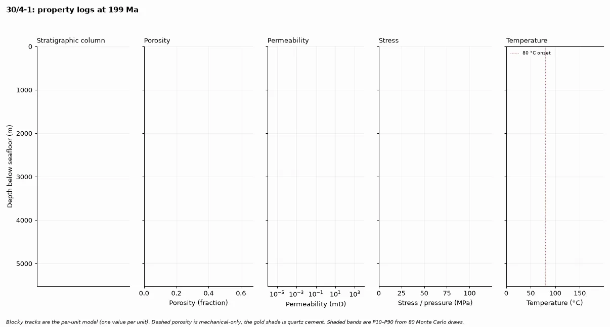
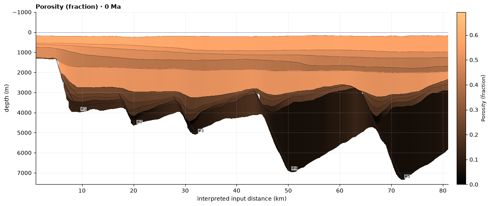
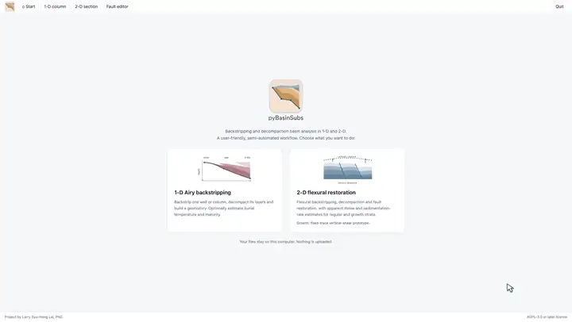
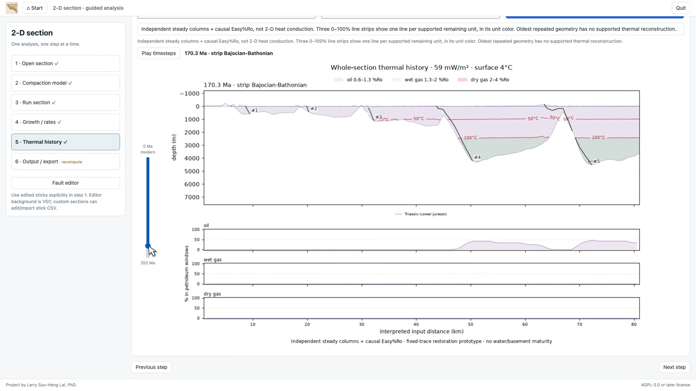
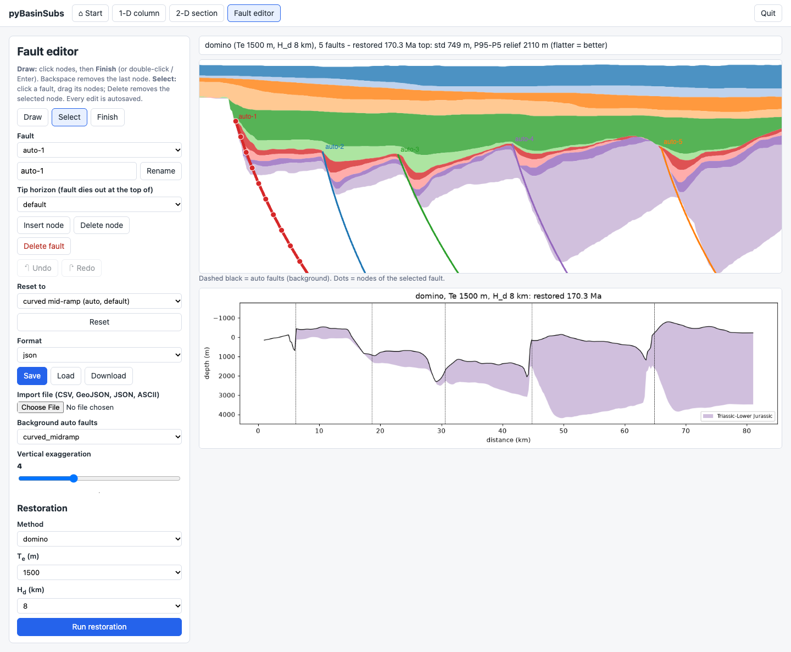

<p align="center"></p>
<p align="center">
<a href="https://doi.org/10.5281/zenodo.23832018"></a> <a href="https://doi.org/10.1038/s43247-022-00429-2"></a> <a href="LICENSE"></a>
<br>
<a href="https://pypi.org/project/pybasinsubs/"></a> <a href="https://pypi.org/project/pybasinsubs/"></a> <a href="https://pepy.tech/projects/pybasinsubs"></a> <a href="https://anaconda.org/conda-forge/pybasinsubs"></a> <a href="https://anaconda.org/conda-forge/pybasinsubs"></a>
</p>

# pyBasinSubs

> [!WARNING]
> Under active development. Many functions, especially fault restoration, are experimental and not fully validated. Use geological constraints; a restored section is not a unique solution.

**pyBasinSubs** is a tool for **1-D and 2-D backstripping and decompaction basin analysis**, with a user-friendly, semi-automated workflow. Start with a well, stratigraphic column or interpreted section; explore subsidence, burial, thermal history, structural restoration and property modeling in the local browser app or Python notebooks.

## Citation

Lai, L.S.-H. (2026) pyBasinSubs. *Zenodo*, [doi:10.5281/zenodo.23832018](https://doi.org/10.5281/zenodo.23832018) (concept DOI).

Please also cite the method paper: Lai et al. (2022), *Extremely rapid up-and-down motions of island arc crust during arc-continent collision*, [Communications Earth & Environment 3, 100](https://doi.org/10.1038/s43247-022-00429-2).

Code: **AGPL-3.0-or-later**. Data and method credits are in [NOTICE](NOTICE), including Sodir, Roberts et al. (1998), Miller et al. (2020) and IHFC (2024). The Miller sea-level curve is downloaded on first use, not bundled; its non-commercial terms still apply.

## Install and run

Requires Python 3.12 or newer. Install the published package:

```bash
pip install pybasinsubs
```

Start the local browser app:

```bash
pybasinsubs-app
```

For an optional editable install from source, run this from the project folder:

```bash
pip install -e .
```

`python -m pybasinsubs.webapp` also starts the app. It runs locally; your input files stay on your computer. `pybasinsubs-ui` is an alias, and `pybasinsubs-tracer` opens the fault editor directly.

## 1-D: from a well to basin history

Backstrip sediment loads with **Airy isostasy and decompaction**, including erosion, over-compaction and Monte Carlo uncertainty. Use a bundled well or your own column CSV. Optional thermal tools cover geotherms, McKenzie stretching-factor fits, burial temperature and Easy%Ro maturity.

[](image/videos/hero_geohistory_north_sea_30-4-1.mp4)
*North Sea well 30/4-1 — **1-D Airy backstripping + decompaction**.*

[](image/videos/thermal_history_north_sea_30-4-1.mp4)
*North Sea well 30/4-1 — **thermal column + geotherm**.*

## 2-D: strip layers, restore and inspect rates

Use correlated horizons, unit properties and interpreted fault sticks for **flexural backstripping and decompaction**. Explore cantilever, listric and domino restoration options, or the fixed-trace growth-history prototype below.

[](image/videos/vg1_growth_restoration.mp4)
*Viking Graben VG1 — **fixed-trace vertical-shear reconstruction**.*

[](image/videos/vg1_section_thermal_history.mp4)
*Viking Graben VG1 — **whole-section thermal history**.*

The growth prototype infers **nonnegative, distributed apparent throw** after stripping, decompaction and flexural unloading. It is **not resolved down-dip slip, geological heave or curved-fault balancing**. Zero is an assumed datum. The footwall of the westernmost fault is flattened separately toward the datum and is not counted as throw. Traces remain user-controlled inputs.

## Property modeling

This step walks the existing 1-D geohistory or 2-D restoration through time and records porosity, quartz cement, permeability and stress. New porosities do **not** feed back into decompaction, isostasy or conductivity: calling `backstrip` or running the earlier wizard steps still produces the 0.2.0 results.

Mechanical compaction follows the exponential effective-stress law used as the plastic part of Schneider et al. (1996), written with a residual intergranular volume as in Lander & Walderhaug (1999). Quartz cement uses Walderhaug (1996) and is applied only to the sandstone end-member. Sand permeability is Kozeny–Carman; mudstone permeability is Yang & Aplin (2010); chalk uses the Mortensen / Fabricius Kozeny form. Pore pressure is hydrostatic (Terzaghi effective stress).

The 1-D display is a fixed well-log frame: an ICS-coloured stratigraphic column plus porosity, permeability, stress and temperature + Easy%Ro tracks. Depth and value ranges are measured once across every time step, then held constant so animation frames do not jump.


*North Sea well 30/4-1 — **present-day property logs**.*

[](image/videos/property_logs_north_sea_30-4-1.mp4)
*North Sea well 30/4-1 — **property-log animation**.*

On a restored section the same 1-D model is applied independently at each $x$. Each figure shows one property (porosity, permeability or effective stress) at one restoration age, with colour limits shared across ages.


*Viking Graben VG1 — **present-day porosity**.*

Package entry points include `evolve_properties`, `evolve_section_properties`, `plot_property_logs`, `save_property_logs_animation`, `plot_section_property` and `save_section_property_animation`. Notebooks 6 and 8 document the equations, citations and limitations; the local browser app adds a Property modeling step after thermal history in both wizards.

## The local browser app

The start page has the package logo and **two symbolic function buttons**. **Fault editor** is available from Start and the 2-D workflow, not inside the 1-D wizard or as a third landing card. A small footer stays outside the workspace: “Project by Larry Syu-Heng Lai, PhD.” at the left and “AGPL-3.0 or later license” at the right.

The app uses isolated numbered left-step wizards: open/edit inputs, choose or fit compaction curves, compute, then export. Return to Start to choose a different analysis. Earlier edits invalidate downstream results. Real-point fits and geothermal imports are explicit. Choose one dataset; porosity-curve checkboxes control the plot, not which unit lithologies are decompacted.

The 1-D steps are **stratigraphy + aligned paleo-water inputs → compaction relations → geohistory + table → geothermal conditions + thermal plots/tables → property modeling → export**. The 2-D steps are **interpreted section → compaction relations → ordinary flexural backstripping/decompaction → explicit growth reconstruction + rates → thermal history (isotherms, Easy%Ro window overlays and percent-in-window lines) → property modeling → export**. Real porosity points are shown and used for supported fits when supplied; sparse or unsuitable data retain the chosen curves. Bundled VG1/well-top examples provide model curves, not measured porosity logs.

### 1-D column demo

[](image/videos/pyBasinSubs_column_demo.mp4)
*North Sea well 30/4-1 — **step-by-step Airy backstripping, thermal history and property modeling**. Click it to [watch the video](image/videos/pyBasinSubs_column_demo.mp4).*

### 2-D section demo

[](image/videos/pyBasinSubs_section_demo.mp4)
*Viking Graben VG1 — **step-by-step flexural backstripping, growth reconstruction, thermal history and property modeling**. Click it to [watch the video](image/videos/pyBasinSubs_section_demo.mp4).*

Growth reconstruction does **not** run on page load or ordinary **Run section**. Blank section uploads use the bundled VG1 template; supply both horizons and units CSVs for your own section, plus optional fault sticks.

### Interpret your own fault traces


*Viking Graben — **fault-stick digitizing**.*

## Quick start in Python

```python
from pybasinsubs import from_sodir, backstrip
from pybasinsubs.plotting import geohistory

result = backstrip(from_sodir("30/4-1"), n=500)
geohistory(result)
result.summary()
```

Use `read_column("my.csv")` for your own column, or `from_basinsubs("N")` for the northern Coastal Range example; both are available from `pybasinsubs`. The `legacy` module retains the original [BasinSubs R workflow](https://github.com/GeoLarryLai/BasinSubs).

## Notebooks

The executed [notebooks](notebooks/) explain data preparation, assumptions and validation, using the same calculation engines as the app.

| Start here | What you will learn |
|---|---|
| [1 · Porosity](notebooks/pyBasinSubs_1_porosity_fit.ipynb) / [2 · Paleo-water depth](notebooks/pyBasinSubs_2_paleowater_depth.ipynb) | Compaction fits and water-depth estimates from microfossils. |
| [3 · Coastal Range](notebooks/pyBasinSubs_3_coastal_range_backstrip.ipynb) / [4 · R parity](notebooks/pyBasinSubs_4_R_parity.ipynb) | Taiwan subsidence examples and checks against the original workflow. |
| [5 · Your data and the app](notebooks/pyBasinSubs_5_own_data_and_UI.ipynb) | Column/section CSV templates and browser workflows. |
| [6 · Thermal history](notebooks/pyBasinSubs_6_north_sea_thermal.ipynb) | North Sea and Barents Sea temperature and maturity, plus 1-D property modeling. |
| [7 · Well-transect flexure](notebooks/pyBasinSubs_7_2D_flexure.ipynb) | Well-based loads, flexural profiles and elastic-thickness sensitivity; not fault-resolved restoration. |
| [8 · 2-D backstripping](notebooks/pyBasinSubs_8_2d_flexural_backstripping.ipynb) / [9 · Fault interpretation](notebooks/pyBasinSubs_9_fault_interpretation.ipynb) | Correlated sections, interpreted faults, restoration comparisons, the growth prototype and section property views. |


## References

**Mechanical compaction and quartz cement**
- Schneider, F., Potdevin, J. L., Wolf, S. & Faille, I. (1996). Mechanical and chemical compaction model for sedimentary basin simulators. *Tectonophysics* 263, 307–317.
- Lander, R. H. & Walderhaug, O. (1999). Predicting porosity through simulating sandstone compaction and quartz cementation. *AAPG Bulletin* 83, 433–449.
- Walderhaug, O. (1996). Kinetic modeling of quartz cementation and porosity loss in deeply buried sandstone reservoirs. *AAPG Bulletin* 80, 731–745.
- Bowers, G. L. (1995). Pore pressure estimation from velocity data: accounting for overpressure mechanisms besides undercompaction. *SPE Drilling & Completion* 10, 89–95.
- Bjørlykke, K. & Jahren, J. (2012). Open or closed geochemical systems during diagenesis in sedimentary basins: constraints on mass transfer during diagenesis and the prediction of porosity in sandstone and carbonate reservoirs. *AAPG Bulletin* 96, 2193–2214.
- Athy, L. F. (1930). Density, porosity, and compaction of sedimentary rocks. *AAPG Bulletin* 14, 1–24.

**Permeability**
- Kozeny, J. (1927). Über kapillare Leitung des Wassers im Boden. *Sitzungsberichte der Akademie der Wissenschaften in Wien* 136, 271–306.
- Carman, P. C. (1937). Fluid flow through granular beds. *Transactions of the Institution of Chemical Engineers* 15, 150–166.
- Yang, Y. & Aplin, A. C. (2010). A permeability–porosity relationship for mudstones. *Marine and Petroleum Geology* 27, 1692–1697.
- Mortensen, J., Engstrøm, F. & Lind, I. (1998). The relation among porosity, permeability, and specific surface of chalk from the Gorm field, Danish North Sea. *SPE Reservoir Evaluation & Engineering* 1, 245–251 (SPE-31062-PA).
- Fabricius, I. L. (2007). Chalk: composition, diagenesis and physical properties. *Bulletin of the Geological Society of Denmark* 55, 97–128.
- Mallon, A. J., Swarbrick, R. E. & Katsube, T. J. (2005). Permeability of fine-grained rocks: new evidence from chalks. *Geology* 33, 21–24.

**Stress, temperature and maturity**
- Terzaghi, K. (1925). *Erdbaumechanik auf bodenphysikalischer Grundlage*. Deuticke.
- Jáky, J. (1944). The coefficient of earth pressure at rest. *Journal of the Society of Hungarian Architects and Engineers* 78, 355–358.
- Sweeney, J. J. & Burnham, A. K. (1990). Evaluation of a simple model of vitrinite reflectance based on chemical kinetics. *AAPG Bulletin* 74, 1559–1570.

**Basin analysis (existing pyBasinSubs methods)**
- Lai, L. S.-H., Lin, A. T.-S. & Lallemand, S. (2022). Extremely rapid up-and-down motions of island arc crust during arc-continent collision. *Communications Earth & Environment* 3, 100.
- Sclater, J. G. & Christie, P. A. F. (1980). Continental stretching: an explanation of the post-mid-Cretaceous subsidence of the central North Sea Basin. *Journal of Geophysical Research* 85, 3711–3739.

Release history and migration notes: [CHANGELOG.md](CHANGELOG.md).
