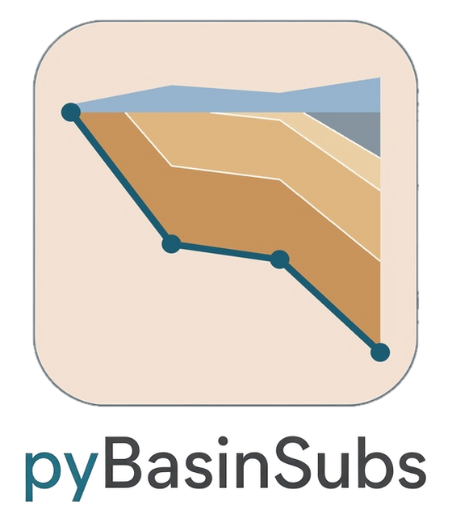
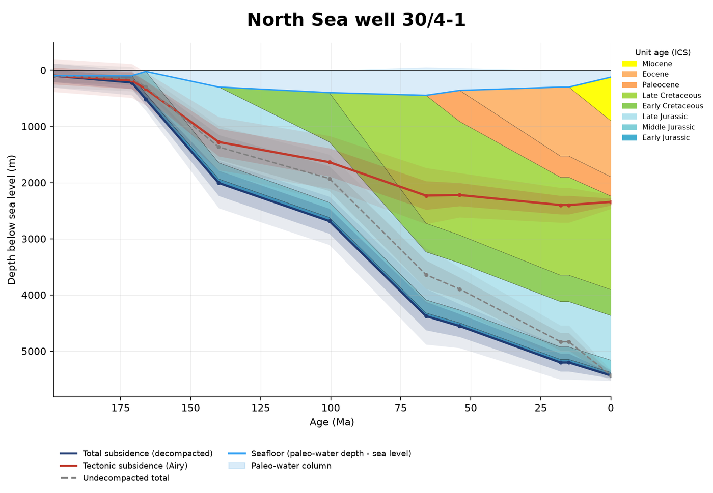
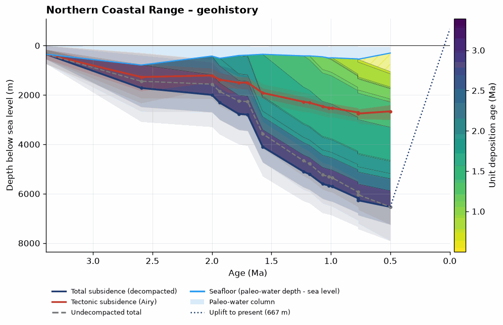
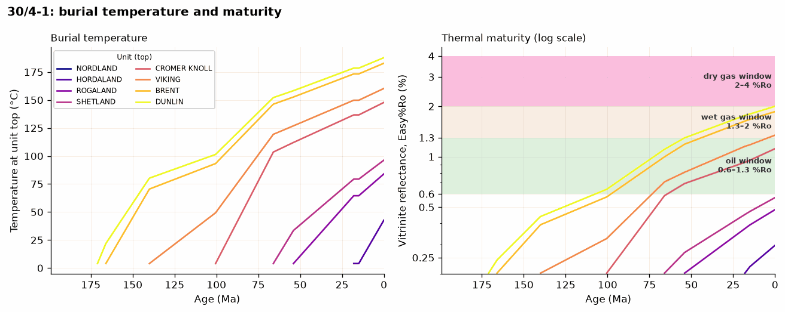
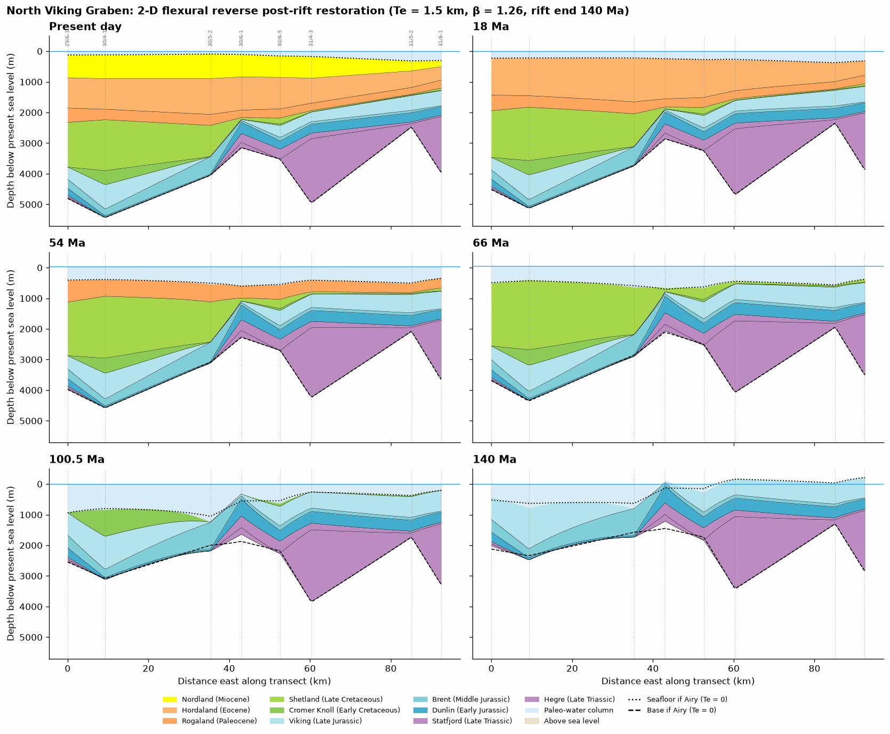

<p align="center"></p>

# pyBasinSubs

[](https://pypi.org/project/pybasinsubs/) [](https://pepy.tech/project/pybasinsubs) [](https://doi.org/10.5281/zenodo.23832018) [](./LICENSE)

v0.1.1

> [!WARNING]
> **pyBasinSubs** is under active development, and many functions are still experimental and not fully validated. Please use with caution.

**pyBasinSubs** reconstructs how a sedimentary basin sank and filled through time by backstripping its layers. It's the Python version, and an extension, of my original R code, BasinSubs.

**BasinSubs (R, original):** https://github.com/GeoLarryLai/BasinSubs. This is the code behind our Coastal Range (eastern Taiwan) work:
- Lai, L.S.-H., Dorsey, R.J., Horng, C.-S., Chi, W.-R., Shea, K.-S., and Yen, J.-Y. (2021) Polygenetic mélange in retrowedge foredeep of an active arc-continent collision, Coastal Range of eastern Taiwan. *Sedimentary Geology*, v. 418, 105901. https://doi.org/10.1016/j.sedgeo.2021.105901
- Lai, L.S.-H., Dorsey, R.J., Horng, C.-S., Chi, W.-R., Shea, K.-S., and Yen, J.-Y. (2022) Extremely rapid up-and-down motions of island arc crust during arc-continent collision. *Communications Earth & Environment*, v. 3, no. 1, 100. https://doi.org/10.1038/s43247-022-00429-2

**pyBasinSubs (Python, new):** it brings that backstripping workflow into Python and goes further: Monte Carlo uncertainty, thermal history and maturity, 2-D flexural backstripping and section restoration, CSV templates and apps for your own data. The `legacy` module reproduces the BasinSubs R results.

## Installation

```bash
pip install pybasinsubs
```

From source:

```bash
git clone https://github.com/GeoLarryLai/pyBasinSubs && cd pyBasinSubs
pip install -e .                          # or: conda env create -f environment.yml
pip install -r requirements-dev.txt && python -m pytest -q
```

## Citation

Lai, L.S.-H. (2026) pyBasinSubs. *Zenodo*, [https://doi.org/10.5281/zenodo.23832018](https://doi.org/10.5281/zenodo.23832018)

Please also cite the method paper:
[Lai et al. (2022)](https://doi.org/10.1038/s43247-022-00429-2).
Other references: [Roberts et al. (1998)](https://doi.org/10.1144/petgeo.4.4.327),
[Miller et al. (2020)](https://doi.org/10.1126/sciadv.aaz1346) (sea-level curve, downloaded on first use, not shipped),
[IHFC (2024)](https://doi.org/10.5880/fidgeo.2024.014). Data credits are in `NOTICE`.


*A geohistory (burial) plot for North Sea well 30/4-1, showing how the basin sank and filled through time.*

## What it can do

- 1-D Airy backstripping with Monte Carlo uncertainty, erosion and over-compaction (`legacy` reproduces BasinSubs R results)
- Porosity–depth fits with confidence bands, and paleo-water depth from foraminifera
- Thermal history: geotherms, McKenzie β fit, Easy%Ro maturity, and oil/gas windows
- 2-D flexural backstripping, T_e fitting and fault restoration across a section
- Load your own data from CSV templates, or use the desktop and Streamlit apps

## Examples


*Northern Coastal Range (Taiwan): a geohistory with total and tectonic subsidence and their uncertainty bands.*


*North Sea well 30/4-1: burial temperature and maturity (Easy%Ro), with the oil and gas windows marked.*


*A 2-D section across the North Viking Graben, restored step by step through time by flexural backstripping.*

Executed notebooks in `notebooks/` cover each feature (re-run with `python tools/run_notebooks.py`).

## Quick start

```python
from pybasinsubs import from_sodir, backstrip
from pybasinsubs.plotting import geohistory

r = backstrip(from_sodir("30/4-1"), n=2000)   # or from_basinsubs("N"), read_column("my.csv")
geohistory(r); r.summary()
```

Apps: `pybasinsubs-ui` (backstripping), `pybasinsubs-tracer` (fault editor and restoration);
add `--streamlit` for the Streamlit versions.

